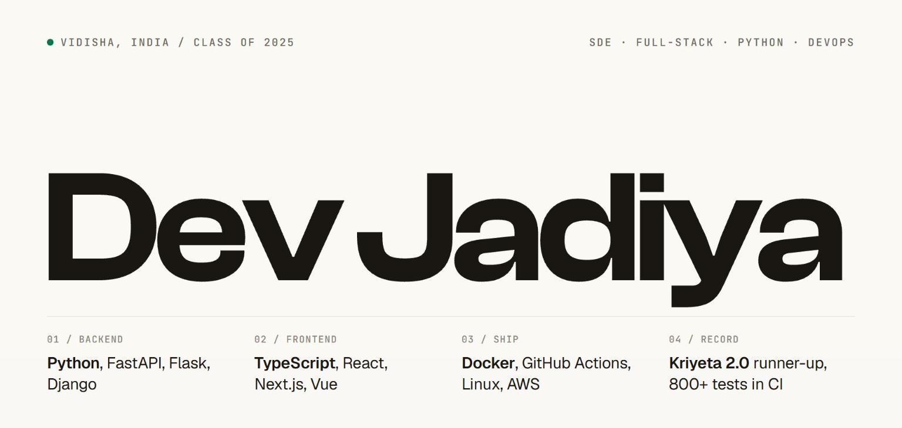

I build web products end to end, from the database to the deploy. Python on the backend, TypeScript on the front, and pipelines that ship every push. CS graduate, SATI Vidisha, 2025. Looking for **SDE, full-stack, Python or DevOps** roles.

### Work

**Pentellia, EncodersPro** · Developer intern, 2025 to 2026 
Full-stack integration, database design, hosting and deployment for an AI security-scanning platform.

**Cobox** · AI engineer, 3 months 
Python and FastAPI services, push-to-deploy on AWS EC2 with GitHub Actions, Nginx and systemd. Worked alongside the Unreal Engine desktop game team.

**Freelance** · 2023 onward 
Design-to-deploy builds for clients in India and the Gulf, including [Memo Music Label](https://memomusiclabel.com) and [Maison Tatiana](https://maisontatiana7worldwide.com).

### Things I built

| | | |
|---|---|---|
| [Election Violence Monitor](https://election-violence-monitor.vercel.app) | Incident mapping platform, built with partners in Nigeria | Next.js, TypeScript |
| [Clip2Commons](https://clip2commons.toolforge.org) | Video encoding in the browser with WebCodecs, 800+ tests in CI · [source](https://gitlab.wikimedia.org/toolforge-repos/clip2commons) | Vue 3, TypeScript, Vite |
| [WhichTool](https://whichtool.toolforge.org) | Search across 50+ languages, keyword plus embeddings · [source](https://gitlab.wikimedia.org/toolforge-repos/whichtool) | Python, Flask |
| [WikiScriptSync](https://gitlab.wikimedia.org/toolforge-repos/script-publisher) | Syncs scripts from GitHub to production wikis, security reviewed | Django |
| [Submify](https://submify.online) | Automated grading for college projects, with plagiarism and code-quality checks | Next.js, Firebase |

### Wins

First runner-up, Kriyeta 2.0 (₹50,000) · 4th runner-up of 1,180, HackHound 2.0 · Best UI/UX, Core Nexus Web3 · 700+ LeetCode

 

[devjadiya.com](https://devjadiya.com) · [LinkedIn](https://linkedin.com/in/devjadiya) · [contact@devjadiya.com](mailto:contact@devjadiya.com) · [Wikimedia](https://meta.wikimedia.org/wiki/User:Dev_Jadiya)
